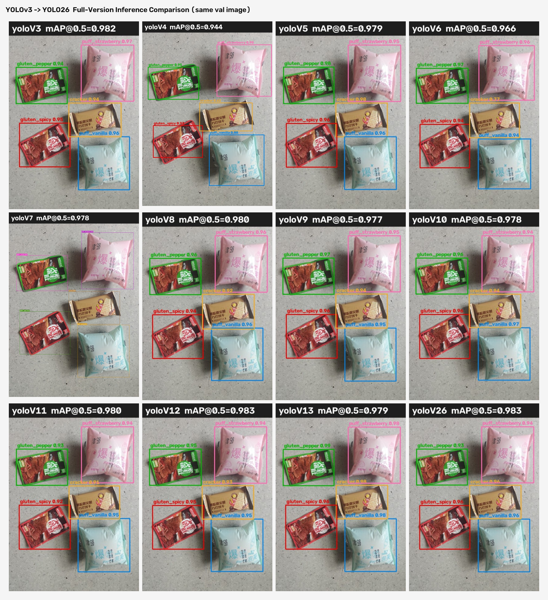

# 项目演示说明（访客导览版）

> 面向访客与演示场景的 5 分钟导览：这个项目**做了什么**、**成果在哪里**、**怎么亲手体验**。
> 适合：第一次看到本仓库的人 / 需要把它演示给别人看的场景。

---

## 一、30 秒了解

- **一句话**：在一台 RTX 5060 笔记本上，把 **YOLOv3 → YOLO26 全部 12 个版本**训练跑通，并用同一套数据做了横向对比。
- **检测场景**：零食产品检测（5 类：香草泡芙、草莓泡芙、香辣素毛肚、山椒素毛肚、苏打饼干盒）
- **核心成绩**：**12/12 全部跑通**，验证集最高 **mAP@0.5 = 0.983**（YOLOv12 / YOLO26）
- **项目特色**：171 张自建数据集（按连拍组划分防泄漏）+ 自动预标注流水线（效率提升约 80%）+ 完整中文文档

## 二、成果速览（最快 2 分钟看完）

| 想看什么 | 去哪里看 |
|----------|----------|
| **12 个版本的成绩排名** | 本仓库首页 README 的「成绩总览」表格 |
| **各版本实战效果** | 下方效果对比图 / `results/12版本推理对比.jpg` |
| **训练过程曲线** | `results/curves/` 目录（12 张） |
| **可下载的模型权重** | `weights/` 目录（10 个版本）+ Releases 页面（完整包） |
| **完整中文文档** | `docs/` 目录（使用说明详细版 / GitHub 上传说明） |

### 同一张图 × 12 个版本的效果对比



> 所有版本都能正确识别 5 类目标（图中每个子图的标题标注了该版本的成绩）。

## 三、5 分钟亲手体验

### 方式 A：只看不跑（零安装）

浏览 README 成绩表 → 看上面的对比图 → 打开 `results/成绩单.md`。

### 方式 B：跑一次推理（推荐，约 5 分钟）

**第 1 步**：下载权重（二选一）
- 在 Releases 页面下载 `yolo-v3-v26-12versions-weights.zip`（全部 12 个版本）
- 或直接克隆仓库，使用 `weights/` 里的 10 个轻量版本

**第 2 步**：安装依赖

```bash
pip install ultralytics
```

**第 3 步**：运行推理（10 行代码）

```python
from ultralytics import YOLO

model = YOLO("weights/yoloV12_best.pt")          # 换成你的权重路径
results = model.predict("your_image.jpg", imgsz=640, conf=0.25, save=True)

for box in results[0].boxes:
    print(model.names[int(box.cls[0])], f"{float(box.conf[0]):.2f}")
```

**预期结果**：识别出图片中的零食类别与置信度，同时在 runs/ 目录生成带框结果图。

## 四、演示脚本（现场演示时照此进行，约 5 分钟）

1. **打开仓库首页**（30 秒）：指出 About 描述与 README「成绩总览」——强调"12 个版本全部跑通，最高 0.983"；
2. **下滑到效果对比图**（1 分钟）：强调"这是同一张图，用 12 个不同版本跑出来的结果，全部正确检出"；
3. **打开 Releases 页面**（1 分钟）：说明权重已打包开放下载，任何人都能复现推理；
4. **终端现场运行一次推理**（1.5 分钟）：用方式 B 的三步命令，展示带框输出图；
5. **打开 docs/ 与 results/**（1 分钟）：展示文档与曲线的完整度，收尾。

## 五、常见提问 Q&A

**Q1：数据是从哪来的？**
作者实拍 171 张（55 个连拍组，5 类商品），按连拍组 80/20 划分训练/验证，避免近重复图片造成的数据泄漏。

**Q2：为什么要训练 12 个版本？**
做版本演进研究：同数据、同评测口径，直观对比从 v3 到 v26 各代模型的效果差异，也为实际选型提供参考。

**Q3：可以直接拿去商用吗？**
不可以。本项目仅供学习研究与技术交流；商业使用需处理 Ultralytics 的 AGPL 许可（申请企业许可），数据集照片中的品牌素材也需获得权利人授权。详见 README「用途声明」。

**Q4：怎么换成我自己的产品？**
见 `docs/YOLO全版本检测项目使用说明_详细版.docx` 第十章 Cookbook：「换一类产品从头走一遍」的三步流程。

**Q5：需要什么硬件才能复现？**
训练：6GB+ 显存的 NVIDIA 显卡即可（本项目用 8GB 的 RTX 5060）；推理：普通 CPU 也可以（速度稍慢）。

## 六、延伸阅读

| 文档 | 内容 |
|------|------|
| `README.md` | 项目总览、快速开始、成绩表 |
| `docs/YOLO全版本检测项目使用说明_详细版.docx` | 完整使用手册（推理/训练/标注/FAQ/Cookbook） |
| `docs/GitHub上传说明.md` | 如何把类似项目发布到 GitHub（含合规要点） |
| `THIRD_PARTY_NOTICES.md` | 第三方开源组件协议标注 |

---

*本项目仅供学习研究与技术交流使用，请勿用于商业用途。*
